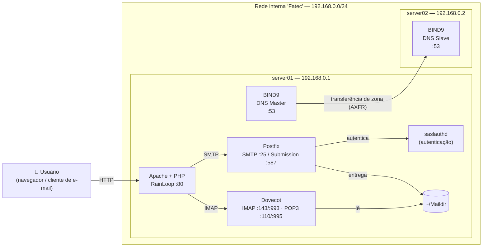

# 📧 Servidor de E-mail e DNS em Debian 13

Infraestrutura completa de e-mail corporativo montada do zero em máquinas virtuais, com **DNS Master/Slave (BIND9)**, **SMTP (Postfix)**, **IMAP/POP3 (Dovecot)**, **autenticação SASL** e **webmail (RainLoop)**, seguida de uma **auditoria de segurança** do ambiente.

> Projeto desenvolvido em laboratório acadêmico (Fatec, 2026), em rede isolada no VirtualBox.


---

## 🗺️ Arquitetura



| Máquina | Função | IP interno | Serviços |
|---|---|---|---|
| `server01` | DNS primário + servidor de e-mail | `192.168.0.1` | BIND9, Postfix, Dovecot, saslauthd, Apache, RainLoop |
| `server02` | DNS secundário | `192.168.0.2` | BIND9 (slave) |

Cada VM tem **2 placas de rede**: `enp0s3` em NAT (internet, para instalar pacotes) e `enp0s8` na rede interna `Fatec` (comunicação entre os servidores).

---

## 🌐 DNS

- **Domínio:** `aluno-igorperencine.com.br`
- **Zona direta:** registros `NS`, `A` e `CNAME` para `server01` / `server02` → [`zones/aluno-igorperencine.com.br`](server01-master/etc/bind/zones/aluno-igorperencine.com.br)
- **Zona reversa:** `0.168.192.in-addr.arpa` com registros `PTR` → [`zones/db.0.168.192`](server01-master/etc/bind/zones/db.0.168.192)
- **Alta disponibilidade:** o `server02` recebe automaticamente uma cópia da zona do `server01` via transferência de zona, restrita por `allow-transfer` ao IP do slave.

## ✉️ Fluxo de um e-mail

1. O usuário entra no **webmail** (RainLoop) pelo navegador.
2. Ao enviar, o RainLoop entrega a mensagem ao **Postfix** via SMTP.
3. O Postfix descobre que o destino é um domínio local (`mydestination`) e grava a mensagem no **`~/Maildir`** do destinatário.
4. O **Dovecot** lê o `Maildir` e disponibiliza a mensagem via **IMAP/POP3**.
5. Clientes externos que enviam pela porta **587 (submission)** precisam de **TLS + usuário/senha**, validados pelo **saslauthd** contra as contas do sistema.

---

## 📁 Estrutura do repositório

```
.
├── server01-master/
│   ├── etc/bind/          # named.conf.local, zonas direta e reversa
│   ├── etc/postfix/       # main.cf, master.cf (submission), sasl/smtpd.conf
│   ├── etc/dovecot/       # dovecot.conf e conf.d (auth, mail, master, ssl)
│   ├── etc/apache2/       # VirtualHost do webmail
│   ├── etc/network/       # interfaces (NAT + rede interna)
│   └── webmail/           # configuração do domínio no RainLoop
├── server02-slave/
│   └── etc/bind/          # zona slave
└── docs/
    ├── instalacao.md      # passo a passo para reproduzir
    └── analise-seguranca.md  # auditoria do ambiente e correções
```

> 🔒 **Arquivos sensíveis foram removidos de propósito:** chave `rndc.key`, `SALT.php`, sessões e configuração do painel admin do RainLoop, e histórico de comandos. Nenhuma senha está neste repositório.

---

## 🚀 Como reproduzir

O passo a passo completo está em **[docs/instalacao.md](docs/instalacao.md)**. Resumo:

```bash
# server01
apt install bind9 bind9-utils postfix sasl2-bin dovecot-imapd dovecot-pop3d \
            apache2 php libapache2-mod-php php-xml php-zip php-curl
# server02
apt install bind9 bind9-utils
```

## ✅ Validação

```bash
dig @192.168.0.1 aluno-igorperencine.com.br          # DNS master responde
dig @192.168.0.2 aluno-igorperencine.com.br          # DNS slave responde (zona transferida)
dig @192.168.0.1 -x 192.168.0.2                      # zona reversa
ss -tlnp | grep -E ':(25|587|143|993|110|995|80)\b'   # serviços ouvindo
openssl s_client -connect aluno-igorperencine.com.br:993   # IMAP com TLS
testsaslauthd -u teste -p '<senha>'                  # autenticação SASL
ls ~teste/Maildir/new/                               # e-mail entregue
```

---

## 🛡️ Análise de segurança

Depois de o ambiente funcionar, ele foi auditado como se fosse um servidor de produção. Foram encontrados **12 pontos de melhoria**, classificados por severidade e relacionados ao **MITRE ATT&CK**, cada um com a correção recomendada:

| Severidade | Qtde | Exemplos |
|---|---|---|
| 🔴 Alta | 4 | Senha padrão no painel admin do webmail, webmail sem HTTPS, firewall sem regras, RainLoop descontinuado com CVEs |
| 🟠 Média | 6 | Sem SPF/DKIM/DMARC, DNS sem restrição de consultas, AppArmor desativado, `chmod 777` nas zonas do slave |
| 🟡 Baixa | 2 | Certificados autoassinados, erros de sintaxe no `main.cf` |

👉 Relatório completo: **[docs/analise-seguranca.md](docs/analise-seguranca.md)**

---

## 📚 Lições aprendidas

- **Dovecot 2.4 mudou a sintaxe:** `mail_location = maildir:~/Maildir` deixou de existir e virou `mail_driver = maildir` + `mail_path = ~/Maildir`. Muitos tutoriais na internet ainda usam a forma antiga.
- **Postfix roda em chroot:** o socket do `saslauthd` precisa estar dentro de `/var/spool/postfix/var/run/saslauthd`, senão o Postfix não consegue autenticar ninguém. O usuário `postfix` também precisa estar no grupo `sasl`.
- **Permissões do BIND slave:** o diretório onde o slave grava as zonas precisa pertencer ao usuário `bind`. A tentação de resolver com `chmod 777` funciona, mas abre uma falha de segurança.
- **Funcionar não é estar seguro:** o ambiente funcionava por completo e ainda assim tinha 4 problemas de severidade alta.

---

## ⚠️ Aviso

Ambiente de **laboratório**, em rede isolada e para fins de estudo. As configurações refletem o estado do laboratório **antes** das correções da análise de segurança e não devem ser usadas em produção sem aplicá-las.
